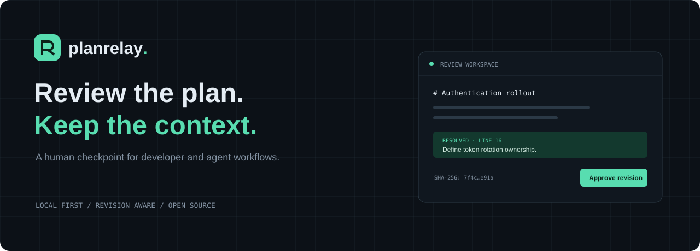
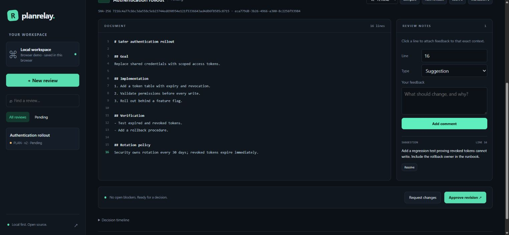

<p align="center"></p>

<p align="center">
  <a href="https://github.com/brunnojob/planrelay/actions/workflows/planrelay.yml"></a>
  
  <a href="LICENSE-MIT"></a>
  
</p>
<p align="center"><a href="#start-in-30-seconds">Quick start</a> · <a href="https://brunnojob.github.io/planrelay/planrelay-demo/">Try the browser demo</a> · <a href="docs/planrelay/ARCHITECTURE.md">Architecture</a> · <a href="docs/planrelay/README.pt-BR.md">Português</a> · <a href="UPSTREAM-README.md">Inherited Plannotator documentation</a></p>

# PlanRelay

**A human checkpoint for plans, code changes and agent feedback.**

PlanRelay builds on [Plannotator](https://github.com/backnotprop/plannotator), preserving its source and history while adding an optional, dependency-free **revision-aware review companion**. Read a plan, attach comments to exact lines, resolve blockers and export a decision tied to the content you actually reviewed.

The problem: a plan changes, but an old “looks good” survives in chat. The companion makes that boundary explicit: **different content, different review**.

> **Status: initial 0.1.0 companion.** This is an independently maintained derivative, not an official Plannotator release. The new companion and inherited suite are separate applications with separate storage. There is no automatic synchronization or agent delivery between them. This project does not claim complete superiority or feature parity with upstream's latest development.

## Why developers might use it

- **Review before implementation.** Catch missing rollback steps, permissions, assumptions and verification work before a developer or agent starts coding.
- **Keep feedback actionable.** A comment includes its exact snapshot, line, severity and resolution state.
- **Avoid stale approvals.** Import updated content under the same ID to create a pending revision. Earlier comments and decisions remain in history.
- **Make handoffs portable.** Export JSON for tools and Markdown for humans; CLI `check` reports whether the latest imported revision is approved.
- **Stay local.** The companion needs Node.js 22+, no npm install, model keys, accounts or paid API. Files stay in a local JSON workspace.

## Two tools, one repository

| Capability | Inherited Plannotator suite | New PlanRelay companion |
| --- | --- | --- |
| Plans and documents | Rich annotation and review surfaces | Line-oriented source review with severity and resolution |
| Code changes | Rich diffs, local VCS and remote PR review | Read-only tracked Git diff capture and patch-line comments |
| HTML artifacts | Rendered artifact annotation | Safe HTML **source** review; no script execution |
| Agent feedback | Existing plugins, hooks, commands and MCP integrations | Explicit JSON/Markdown export for manual or scripted handoff |
| Revision handling | Existing plan history and diff features | SHA-256-bound decisions; changed content starts pending |
| Blocker policy | Existing upstream review flows | Explicit unresolved blockers prevent approval |
| Language and themes | Existing upstream settings | English/PT-BR, dark/light companion interface |
| Runtime | Bun + upstream packages | Node.js 22+; zero third-party runtime dependencies |

The companion is an additional workflow for people who want explicit revision decisions. It does not replace or intercept inherited hooks, and its decisions do not automatically approve an upstream session.

## Start in 30 seconds

```bash
git clone https://github.com/brunnojob/planrelay.git
cd planrelay
node tools/planrelay/cli.mjs import tools/planrelay/example-plan.md
node tools/planrelay/cli.mjs serve --port 4387
```

Open **http://127.0.0.1:4387**. Select a line, leave a note, suggestion or blocker, and decide when the revision is ready. The server prints its address and never launches a browser automatically. Works with Node.js 22+ on Windows, macOS and Linux.

<details><summary><strong>Review a real Git diff</strong></summary>

Run from the repository whose changes you want to review, using the absolute path to the PlanRelay CLI:

```bash
node /path/to/planrelay/tools/planrelay/cli.mjs diff --ref HEAD
node /path/to/planrelay/tools/planrelay/cli.mjs serve --port 4387
```

The command captures tracked changes relative to a ref. It does not include untracked files or execute the reviewed code. Comment line numbers refer to lines in the captured patch, not GitHub's left/right file coordinates.

</details>

<details><summary><strong>Update a plan without losing the previous review</strong></summary>

```bash
node tools/planrelay/cli.mjs list
node tools/planrelay/cli.mjs import PLAN.md --id REVIEW_ID
node tools/planrelay/cli.mjs check REVIEW_ID
```

Replace `REVIEW_ID` with the ID printed by `import` or `list`. Identical content is a no-op; different content appends a version with its own pending decision and empty discussion. Old comments remain on the old version. Use the revision selector to inspect them and **Compare** to show the previous source above the current source.

**Re-import after editing the source before calling `check`.** The CLI checks stored review state; it does not watch a file or prove your current Git tree matches an imported diff. It returns 0 for an approved current imported revision, 2 if review is still required and 1 on errors.

</details>

<details><summary><strong>Export structured feedback for your agent or team</strong></summary>

```bash
node tools/planrelay/cli.mjs export REVIEW_ID --format json
node tools/planrelay/cli.mjs export REVIEW_ID --format markdown
```

Exports include review ID, content digest, decision, readiness, anchored comments and decision events. They do not include the complete document or the whole workspace. Review the export and pass it to your agent through your usual workflow. The companion does not send data automatically or execute instructions found in comments.

</details>

<details><summary><strong>Use the full inherited Plannotator suite</strong></summary>

The complete upstream source remains in `apps/`, `packages/`, `scripts/` and `tests/`. For local source development:

```bash
bun install
bun run build:review
bun run build:hook
bun run build:opencode
bun link
```

The inherited `plannotator` command, plugins, Inbox, rich plan/HTML annotation and code-review surfaces retain their upstream names. Consult the [preserved upstream README](UPSTREAM-README.md) and [development guide](docs/agent-guides/project-and-development.md) for setup and optional integrations. Upstream's install scripts and distribution channels still install **upstream**, not PlanRelay. No inherited npm package or extension has been republished under this project's name.

</details>

## Preview

[Open the interactive browser demo →](https://brunnojob.github.io/planrelay/planrelay-demo/)

The demo runs the same interface and review state machine entirely in your browser, with localStorage persistence and sample content. It has no backend, Git access or automatic agent integrations. Demo reviews stay in that browser; keep one demo tab open and export useful feedback before clearing browser data.



The companion provides a searchable review list, source viewer, anchored discussion, revision history, decision timeline and portable exports.

## Verification

```bash
node --test tools/planrelay/test/review.test.mjs
node tools/planrelay/build-demo.mjs
```

The new suite exercises stale revisions and concurrent edits, blocker approval rules, atomic persistence, corrupt-state preservation, HTTP host/origin/token enforcement, payload limits, CLI exit codes and real Git diff capture. GitHub Actions runs it on Linux, Windows and macOS with Node.js 22 and 24. See [validation notes](docs/planrelay/VALIDATION.md) for what was actually run and limitations.

Inherited upstream deployment/release/periodic workflows are preserved as reference under `docs/upstream-workflows/`, rather than deploying upstream infrastructure or publishing its packages from this repository. The active PlanRelay workflow tests the new companion only. The complete upstream suite has **not** been revalidated here.

## Design boundaries

The companion binds only to loopback and rejects foreign Host/Origin values. Writes require a per-session token. Source content is inserted as text; embedded HTML and scripts never run. The companion makes no telemetry or model API calls. These guarantees cover the companion, not the inherited Plannotator applications, which have their own optional services and settings.

The local JSON store is editable by its owner. Revision hashes bind decisions to content; they are **not** signatures, identity verification or tamper-proof audit evidence. There is no multi-user server, automatic re-anchoring, semantic version diff, remote PR API, MCP server or automatic agent bridge in the new companion. See [architecture and limits](docs/planrelay/ARCHITECTURE.md).

## Contribute

Read [CONTRIBUTING.md](CONTRIBUTING.md). Start with a reproducible bug, a focused test or an accessibility improvement. Use issues for discussion and small PRs for implementation. New companion code lives under `tools/planrelay`; inherited components keep their existing architecture and guidance.

## Attribution and license

PlanRelay is based on **Plannotator by backnotprop and contributors**. The upstream source, authorship history and original license texts are retained. See [NOTICE](NOTICE), [MIT](LICENSE-MIT) and [Apache 2.0](LICENSE-APACHE). Original companion contributions are MIT-licensed. Plannotator names and marks belong to their respective owners; this derivative is not endorsed by them.

Maintained by [Brunno](https://github.com/brunnojob).
